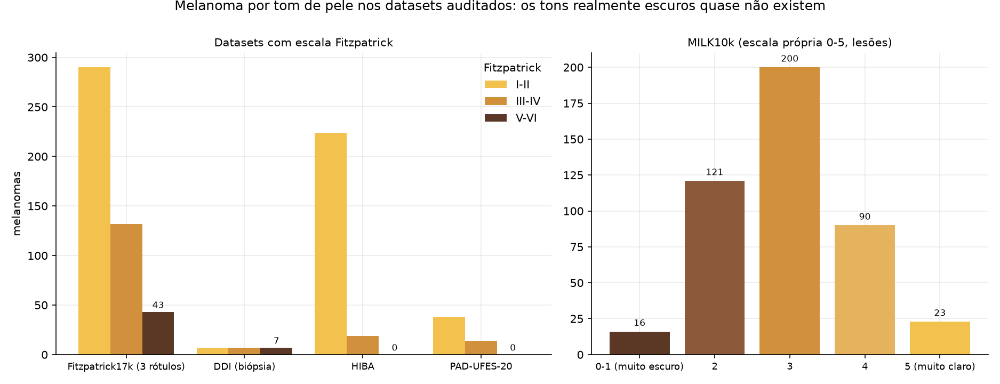

# 02 — Datasets

Nenhum dataset público tem, ao mesmo tempo, **muito melanoma**, **tom de pele anotado** e **confirmação por
biópsia**. Por isso o projeto combina várias fontes com papéis diferentes e audita cada uma. Esta página registra o
que foi usado, o que foi descartado e por quê, os controles de vazamento e a escassez de pele escura.

## 1. Datasets usados

| Dataset | Tipo | Papel | O que entra (mel/nv) | Licença | Versões |
|---|---|---|---|---|---|
| **HAM10000** | dermatoscopia | treino, validação e **teste interno** | treino 771/4.584 · val 166/991 · teste 165/1.001 (imagens) | CC-BY-NC | v1–v7 |
| **ISIC 2020** | dermatoscopia | treino/val | 5.777 imagens mel/nv extraídas de 33.126 (584 mel + 5.193 nv), sem duplicata com o HAM10000 | ver arquivo do ISIC (não verificado aqui) | só v3 |
| **MILK10k** | foto clínica **+** dermatoscopia da mesma lesão | treino/val **e** teste reservado | 1.196 lesões mel/nv (2.392 imagens; 450 mel/746 nv) → 17 lesões descartadas por phash; split 60/10/30 por lesão | CC-BY-NC | v4–v7 (treino); teste em todas |
| **BCN20000** | dermatoscopia (Hospital Clínic de Barcelona) | treino/val | 10.283 imagens mel/nv (4.636 mel em **924 lesões** de melanoma, 5.647 nv; 2.628 lesões) → 8 lesões descartadas; treino 9.185 · val 1.065 | CC-BY-NC | v5–v7 |
| **Fitzpatrick17k** | foto clínica de atlas online | treino (tons I–IV) e teste (tons V–VI) | 629 imagens no treino (421 mel/208 nv); tons V–VI: 43 mel/24 nv ficam fora | termos dos atlas de origem (não verificado) | v7 |
| **PAD-UFES-20** | foto de celular (UFES, Brasil) | **só teste** | 52 imagens de melanoma (36 lesões) e 244 de nevo (215 lesões) | CC BY 4.0 | todas |
| **HIBA** | dermatoscopia + foto clínica (Buenos Aires) | **só teste** | 855 imagens (253 mel/602 nv; 728 lesões; 743 dermatoscópicas e 112 clínicas) | CC-BY | todas |
| **MSK 2020, biópsias consecutivas** | dermatoscopia | **só teste** | 808 imagens (117 mel/691 nv) | CC-BY | todas |
| **DDI** (Stanford) | foto clínica, biópsia | **só teste** (equidade) | 656 imagens, 570 pacientes; 208 FST I-II · 241 III-IV · 207 V-VI; 171 malignas (21 melanomas, 7 por faixa) | acordo de uso em pesquisa (Stanford AIMI) | todas |

Observações:

- O **DDI** rotula "maligno vs benigno" (78 doenças), não só melanoma; a probabilidade de melanoma do modelo é usada
  como escore de malignidade. Linfoma cutâneo, por exemplo, é 56% dos casos malignos da faixa escura e o modelo
  nunca o viu no treino ([05](05-fairness-tom-de-pele.md)).
- O **PAD-UFES-20** só tem 25% dos nevos com biópsia (o resto é diagnóstico clínico); o melanoma é 100% biopsiado.
- No **Fitzpatrick17k** os diagnósticos vêm de atlas online, sem biópsia garantida, e o tom de pele é ruidoso
  (duas anotações independentes de tom, `fitzpatrick_scale` e `fitzpatrick_centaur`, concordam em só 45,8% das
  imagens).

## 2. Pré-processamento (igual para todos)

Imagem → RGB → **resize bilinear 224×224 (PIL, sem recorte; imagens não quadradas são esticadas)** → **JPEG
qualidade 95** → gravada em `data/processed/images_224/`. As imagens novas usam os nomes do ISIC (MILK10k e
BCN20000) ou o prefixo `fz_` + hash MD5 (Fitzpatrick17k). Mesma regra na avaliação.
Por que isso importa: [01 §6](01-visao-geral-e-metodologia.md#6-armadilhas-técnicas-encontradas-e-como-foram-resolvidas).

## 3. Auditoria do arquivo do ISIC (via API, só metadados)

Contagens por coleção (consulta à API `images/search` do ISIC Archive; `mel`/`nevo` conforme o diagnóstico ISIC):

| Coleção | Total | Melanoma | Nevo | Malignos | Clínicas | Dermatoscópicas |
|---|---|---|---|---|---|---|
| HAM10000 | 11.720 | 1.305 | 7.737 | 2.156 | 0 | 11.719 |
| BCN20000 | 18.946 | 4.636 | 5.647 | 8.871 | 0 | 18.946 |
| ISIC 2019 (treino) | 25.331 | 4.522 | 12.871 | 8.473 | 0 | 25.331 |
| ISIC 2020 (treino) | 33.126 | 584 | 5.193 | 584 | 0 | 33.126 |
| ISIC 2024 (treino, recortes de 3D TBP) | 401.059 | **157** | 443 | 393 | 0 | 0 |
| MILK10k | 10.480 | 900 | 1.492 | 7.268 | 5.240 | 5.240 |
| DERM12345 | 12.345 | 400 | 9.952 | 1.167 | 0 | 12.345 |
| "Melanoma e nevo com histopatologia" (coleção 294) | 18.133 | 7.191 | 10.826 | 7.202 | 0 | 18.133 |
| HIBA (Hospital Italiano de Buenos Aires) | 1.616 | 253 | 602 | 751 | 346 | 1.270 |
| Biópsias consecutivas 2020 (MSK) | 1.295 | 117 | 691 | 148 | 0 | 1.295 |
| "Newly-acquired and longer-existing" | 187 | 75 | 112 | 75 | 0 | 187 |
| PAD-UFES-20 | 2.298 | 52 | 244 | 1.089 | 2.298 | 0 |
| MSKCC Skin Tone Labeling | 4.879 | 0 | 0 | 0 | 1.201 | 3.678 |

Dados em [`data/auditoria_datasets_isic.csv`](data/auditoria_datasets_isic.csv).

**Consulta específica a pele escura** (arquivo inteiro do ISIC, mesma API):

| Consulta | Imagens |
|---|---|
| Fitzpatrick **V ou VI**, qualquer diagnóstico | 1.574 (todas benignas: é o MSKCC Skin Tone) |
| Fitzpatrick **V ou VI**, **melanoma** | **0** |
| Fitzpatrick IV, melanoma | 7 |
| Qualquer tom anotado, melanoma | 541 (quase tudo tons I–III) |
| Melanoma, total no arquivo | 11.324 |

## 4. Candidatos avaliados e decisões

| Candidato | Decisão | Motivo |
|---|---|---|
| **BCN20000** | usado (v5) | 924 lesões de melanoma (o treino original da v2 tinha 428), sem sobreposição de ID/lesão com HAM10000, ISIC 2020 e MILK10k |
| **MILK10k** | usado (v4) | única fonte aberta com melanoma em foto clínica biopsiada e a mesma lesão em dermatoscopia |
| **Fitzpatrick17k** | usado (v7), com ressalvas | única fonte com tom V–VI; rótulos de atlas; ver [05](05-fairness-tom-de-pele.md) |
| **Coleção 294** ("mel/nevo com histopatologia") | **descartada** | agregado que **repete** imagens já usadas: 3.523 do HAM10000, 1.487 do ISIC 2020 e 656 lesões do MILK10k sob outros IDs; contaminaria o teste |
| **ISIC 2024 / SLICE-3D** | **descartado** | 401 mil recortes, mas só **157 melanomas** (393 malignos); recortes de 3D TBP, tipo de imagem próprio |
| **DERM12345** | descartado | só 400 melanomas (os nevos não têm histopatologia) |
| **ISIC 2019** | não usado | é HAM10000 + BCN20000 + MSK; o BCN20000 foi obtido diretamente |
| **MSKCC Skin Tone Labeling** | não usado | 4.879 imagens dermatoscópicas, 64 pacientes, Fitzpatrick I–VI balanceado, mas **todas assumidas benignas** (só serviria para medir especificidade por tom); não foi baixado |
| **BALD** (melanoma acral) | descartado | 144 melanomas acrais, mas o próprio artigo aponta ausência de pele muito escura |
| **SCIN** (Google) | descartado | crowdsourced, rótulos de dermatologistas sem biópsia, pouco melanoma |
| **Pipsqueak** | descartado | 16 imagens centrais (80 com augmentation), pequeno demais |
| **Fitzpatrick17k (1ª tentativa)** | abandonado, depois recuperado | 76% dos links de imagem estavam mortos; mais tarde obtivemos o zip completo (16.577 imagens) e o CSV dos autores |
| **PAD-UFES-20, HIBA, MSK 2020, DDI** | usados só como teste | independentes do treino |

## 5. Cobertura de tons de pele (o gargalo do projeto)

| Dataset | claro (I-II) | médio (III-IV) | escuro (V-VI) |
|---|---|---|---|
| Fitzpatrick17k (3 rótulos de melanoma) | 290 | 132 | **43** |
| DDI (melanomas) | 7 | 7 | **7** |
| HIBA | 224 | 19 | **0** |
| PAD-UFES-20 | 38 | 14 | **0** |

MILK10k usa **escala própria de 0 (muito escuro) a 5 (muito claro)**, que **não é Fitzpatrick**. Melanomas por
nível (lesões): 0: 0 · 1: 16 · 2: 121 · 3: 200 · 4: 90 · 5: 23. O grupo "escuro (0–2)" das análises é, na prática,
quase todo nível 2; os níveis realmente escuros (0–1) têm **16 melanomas**.

Conclusão: **melanoma em tons V–VI praticamente não existe em dataset aberto** (as ~50 imagens do Fitzpatrick17k e
os 7 casos do DDI são o que há). Isso limita o que se pode afirmar sobre equidade ([05](05-fairness-tom-de-pele.md),
[07](07-limitacoes-e-trabalhos-futuros.md)).

## 6. Verificações de vazamento

| Verificação | Resultado |
|---|---|
| MILK10k vs HAM10000/ISIC 2020 (phash ≤ 2 em dermatoscopia) | 17 lesões descartadas |
| BCN20000 vs HAM10000, ISIC 2020 e MILK10k (phash ≤ 2) | 8 lesões descartadas |
| Fitzpatrick17k vs testes externos (phash ≤ 2) e vs tons V–VI (≤ 3) | 2 imagens descartadas |
| Sobreposição de ID/lesão dos candidatos com o que já usamos | 0 (BCN20000, HIBA, MSK 2020, DERM12345) |
| **MSK 2020 (teste) vs fontes de treino** (phash) | ISIC 2020: 1 imagem ≤ 2 (13 ≤ 4); HAM10000: 0 (2 ≤ 4); BCN20000: 0 (3 ≤ 4); MILK10k: 0 |

O resultado da MSK 2020 vs ISIC 2020 importa porque a v3 (treinada com ISIC 2020) tem AUC 0,790 no MSK 2020, bem
acima da v2 (0,653): a sobreposição é desprezível, então o ganho não é cópia do teste. É compatível com
semelhança de **domínio** (o ISIC 2020 inclui imagens do MSKCC), não com vazamento de imagens idênticas.

## 7. Licenças e citação

Todos os datasets principais são de uso **acadêmico/não comercial**; citar o artigo de cada um no texto do TCC.
Pontos **não verificados** durante o trabalho: os termos do ISIC 2020 e dos atlas que originam o Fitzpatrick17k
(DermaAmin e Atlas Dermatológico). Conferir antes de qualquer redistribuição. As imagens e os checkpoints **não vão
para o git** (`data/` e `*.pt` estão no `.gitignore`).

## 8. Log resumido da pesquisa de datasets

1. **Fitzpatrick17k** foi a primeira escolha (tom de pele nativo), mas cobre 114 condições genéricas (não só
   melanoma) e 76% dos links estavam mortos → abandonado.
2. Decisão do escopo: **melanoma**, não "todas as doenças de pele". Estratégia: **HAM10000** (volume de melanoma, sem
   tom) para treino + **DDI** (tom balanceado, biópsia) para equidade; classificação `mel` vs `nv`.
3. Tentativa de mais dado: **ISIC 2020** (v3) — não melhorou o HAM10000 e **piorou** foto clínica e DDI.
4. Descoberta: o gargalo é a **troca de modalidade** (treino só dermatoscópico). Busca de fontes com foto clínica e
   melanoma → **MILK10k** (v4).
5. Auditoria do arquivo do ISIC via API (§3) → **BCN20000** (v5), **HIBA** e **MSK 2020** como testes externos;
   coleção 294 e ISIC 2024 descartadas.
6. **PAD-UFES-20** (Brasil, foto de celular) como teste de uso real.
7. **Fitzpatrick17k** recuperado (zip + CSV dos autores) → v7.

Fontes consultadas: [MILK10k](https://api.isic-archive.com/doi/milk10k/),
[MSKCC Skin Tone](https://api.isic-archive.com/doi/mskcc-skin-tone-labeling-dataset/),
[PAD-UFES-20](https://data.mendeley.com/datasets/zr7vgbcyr2/1), [BALD](https://github.com/kittler/BALD),
[ISIC 2019](https://challenge.isic-archive.com/landing/2019/), [ISIC 2024](https://challenge2024.isic-archive.com),
[BCN20000](https://arxiv.org/abs/1908.02288), [Fitzpatrick17k](https://github.com/mattgroh/fitzpatrick17k),
[DDI](https://aimi.stanford.edu/datasets/ddi-diverse-dermatology-images),
[estimativa de tom de pele em dermatoscopia](https://www.arxiv.org/abs/2602.10265) (aponta < 1% de Fitzpatrick
V–VI no ISIC 2020 e no MILK10k).
