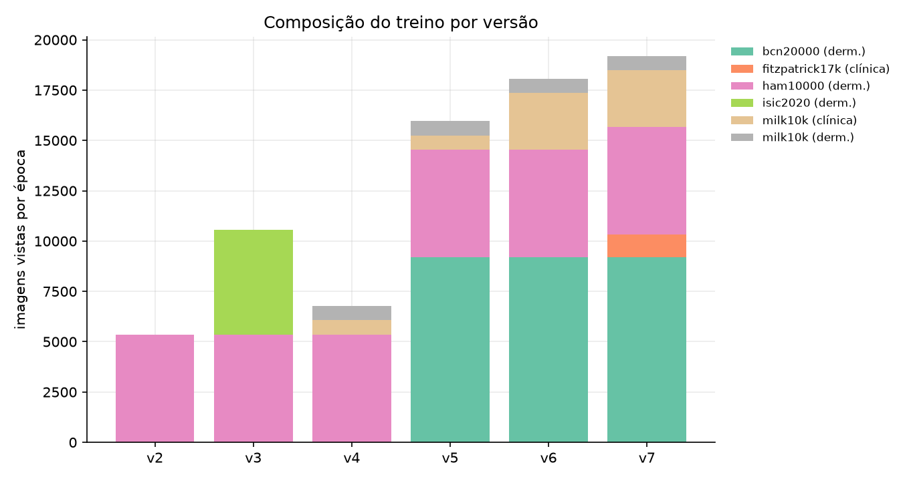
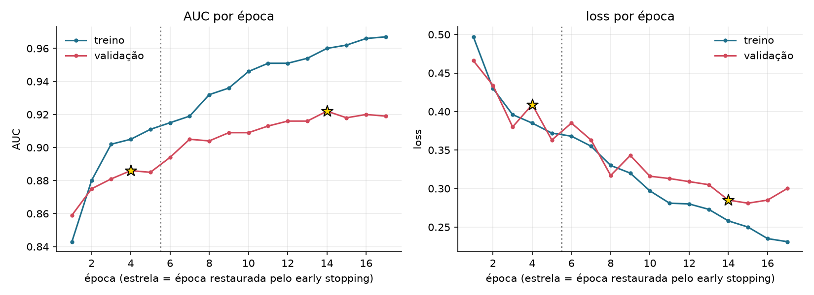
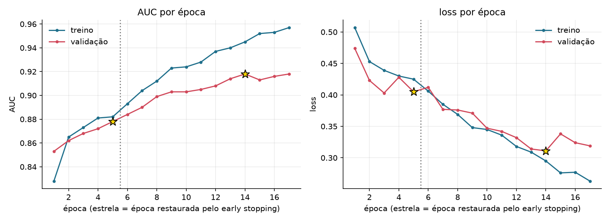
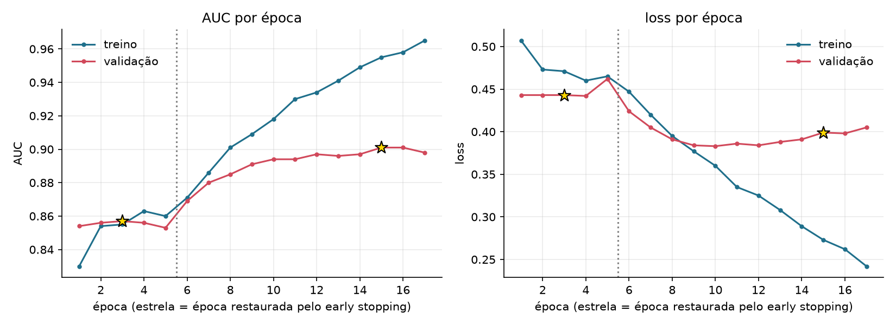
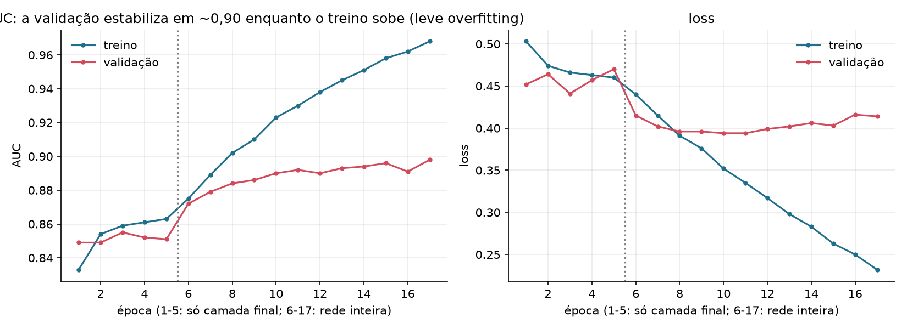

# 03 — Histórico das versões (v1 a v7)

Cada versão muda **uma coisa** em relação à anterior. O treino é sempre o mesmo ([01 §2](01-visao-geral-e-metodologia.md#2-visão-geral-do-pipeline)):
ResNet50, dois estágios (5 + 12 épocas no máximo), AdamW, early stopping pela AUC de validação, limiar = maior valor
com sensibilidade ≥ 0,90 na validação. O que muda é **o que entra no treino**.

## Visão geral

| Versão | O que muda | Treino (imagens/época) | Limiar | AUC val | AUC teste HAM10000 | Papel |
|---|---|---|---|---|---|---|
| **v1** | 5 cópias fixas de cada melanoma, sem early stopping | — | — | 0,89 | recall de mel 0,58 | descartada (overfitting) |
| **v2** | só imagens originais + augmentation aleatório + early stopping | 5.355 (HAM10000) | 0,21 | 0,922 | 0,922 | **linha de base** |
| **v3** | + ISIC 2020 | 10.554 | 0,28 | 0,936 | 0,921 | experimento negativo |
| **v4** | v2 + MILK10k (foto clínica + dermatoscopia) | 6.769 | 0,22 | 0,918 | 0,922 | melhor em foto clínica (isolado) |
| **v5** | v4 + BCN20000 | 15.954 | 0,14 | 0,899 | 0,916 | melhor em dermatoscopia real |
| **v6** | v5 com fotos clínicas do MILK10k repetidas 4× + limiar por modalidade | 18.075 | 0,14 | 0,901 | 0,908 | combina os dois ganhos |
| **v7** | v6 + Fitzpatrick17k (tons I–IV), repetidas 2× | 19.205 | 0,15 | 0,898 | **0,923** | **referência atual** |

As AUC de validação **não são comparáveis entre versões**: a validação de cada versão inclui as fontes que ela
usa. A comparação válida é a dos testes externos ([04](04-resultados-comparacao.md)).

---

## v1 — o primeiro modelo (descartado)

- **Dados:** HAM10000, cada melanoma com 5 cópias fixas geradas na Sprint 1 (para compensar o desbalanceamento).
- **Resultado:** AUC de validação 0,89, **recall de melanoma 0,58 no teste**. O treino chegou a recall 0,99 contra
  ~0,5 na validação: **overfitting claro** (decorou as cópias repetidas), e a loss de validação subia depois do
  mínimo.
- **Lição:** cópias fixas não substituem variação real. Trocadas por augmentation **aleatório a cada época** +
  early stopping + limiar escolhido na validação → v2.
- O checkpoint e o notebook da v1 original não foram preservados; só os números acima (registrados na época).

## v2 — a linha de base

- **Dados:** só as imagens **originais** do HAM10000 (treino 771 mel / 4.584 nv).
- **Treino:** peso do melanoma na loss 3,47; melhor época do estágio 2 = **9** (val AUC 0,922); o early stopping
  parou na 12.
- **Teste HAM10000:** AUC **0,922**, sensibilidade **0,885** e especificidade **0,775** no limiar 0,21 (19
  melanomas perdidos de 165; 225 nevos marcados como suspeitos).
- **Fora de casa:** AUC 0,865 / **0,696** (MILK10k dermatoscopia / foto clínica), 0,642 (PAD-UFES-20), 0,653 (MSK
  2020), 0,620 (DDI). A queda em foto clínica motivou todas as versões seguintes.
- 

## v3 — mais dado do mesmo tipo (experimento negativo)

- **Mudança:** soma o **ISIC 2020** (526 melanomas + 4.673 nevos no treino; 584 + 5.193 no total, sem duplicata com
  o HAM10000). Melanoma no treino: 771 → 1.297 imagens. Teste do HAM10000 idêntico ao da v2 de propósito.
- **Resultado:** HAM10000 **igual** (0,921 contra 0,922). Fora de casa, **pior** em quase tudo:
  HIBA dermatoscopia **−0,203** de AUC contra a v2, MILK10k foto clínica −0,108, DDI −0,068. **Exceção:** MSK 2020,
  **+0,137** (0,790).
- **Leitura:** mais dermatoscopia do **mesmo tipo** não resolve a troca para foto clínica. O ganho no MSK 2020 é
  compatível com semelhança de domínio (o ISIC 2020 inclui imagens do MSKCC); a sobreposição de imagens idênticas
  é desprezível ([02 §6](02-datasets.md#6-verificações-de-vazamento)). **A causa do resultado pior no HIBA, no
  MILK10k clínico e no DDI não foi investigada** (hipótese: outro perfil de imagem e de centros no ISIC 2020).
- O notebook da v3 não tem log salvo, então não há curva de treino (só as métricas recalculadas).

## v4 — foto clínica entra no treino (MILK10k)

- **Motivo:** a Sprint 3 mostrou que o gargalo é a **troca de modalidade**: AUC 0,85 em dermatoscopia do MILK10k
  e 0,66 em foto clínica, e o limiar escolhido em dermatoscopia deixava passar ~66% dos melanomas em foto clínica.
- **Mudança:** soma o **MILK10k** (707 imagens clínicas + 707 dermatoscópicas no treino; 267 melanomas em cada
  modalidade). 30% das lesões ficam reservadas como teste. Treino 6.769 imagens; clínicas ≈ 10%.
- **Resultado (contra a v2):** MILK10k foto clínica **+0,094**, PAD-UFES-20 **+0,079**, DDI **+0,042** (todos
  sustentados); HAM10000 igual.
- **Lição:** foto clínica no treino melhora foto clínica. É a melhor versão em foto clínica do MILK10k (0,790).
- 

## v5 — mais dermatoscopia, diversa (BCN20000)

- **Mudança:** soma o **BCN20000** (9.185 imagens no treino; 4.153 melanomas em ~920 lesões, mais que o dobro das
  428 do treino original). Treino 15.954 imagens.
- **Resultado (contra a v4):** MSK 2020 **+0,099** (população real). Mas MILK10k foto clínica **−0,073**:
  as fotos clínicas caíram de ~10% para ~4% do treino e o ganho clínico da v4 foi **diluído**.
- **Lição:** mais volume de uma modalidade dilui a outra se a proporção não for controlada.

## v6 — sobreamostrar a foto clínica + limiar por modalidade

- **Mudança 1:** as fotos clínicas do MILK10k entram **4 vezes** no treino (4% → 15,6% das imagens por época;
  o augmentation aleatório faz com que as cópias não sejam vistas iguais).
- **Mudança 2:** o notebook passa a calcular, **só na validação**, limiares por modalidade (ver [06](06-limiares-e-metricas.md)).
- **Resultado (contra a v5):** MILK10k foto clínica **+0,066**, PAD-UFES-20 **+0,051**, MSK 2020 **+0,026**
  (sustentados); HAM10000 −0,009 (não sustentado). Mantém o ganho clínico da v4 **e** o da v5 em dermatoscopia real.
- **Lição:** controlar a proporção entre modalidades funciona; a hipótese da v6 foi confirmada em grande parte.
- 

## v7 — Fitzpatrick17k, tons I–IV (referência atual)

- **Mudança:** soma 629 fotos clínicas do **Fitzpatrick17k, só dos tons I–IV** (421 melanomas / 208 nevos
  melanocíticos; 565 no treino, repetidas 2×, e 64 na validação, divididas por grupos de phash). "Lentigo maligna"
  (todas de outra fonte),
  imagens sem tom e **tons V–VI** (43 mel / 24 nv) ficam fora do treino.
- **Desenho original:** treinar em I–IV e testar em V–VI para medir generalização para pele não vista.
  **Esse desenho foi um erro de interpretação:** o teste V–VI tem a **mesma fonte** do treino, então o ganho
  enorme (AUC 0,67 → 0,93) é a rede aprendendo o padrão do atlas, não a pele escura. Detalhes em
  [05](05-fairness-tom-de-pele.md).
- **Resultado (contra a v6, fontes independentes):** HAM10000 **+0,015** (único sustentado, IC +0,001 a +0,030);
  HIBA foto clínica +0,046; DDI +0,021; PAD-UFES-20 +0,017; os demais ≈ 0; MILK10k −0,010 e −0,013 (não sustentados).
- **Contra a v2:** sustentadamente melhor em **5 dos 8 testes** e nunca pior ([04](04-resultados-comparacao.md)).
- **Por que é a referência:** é pelo menos tão boa quanto a v6 em todos os testes independentes, com leve vantagem
  no HAM10000. A escolha entre v6 e v7 é **apertada**; a v7 carrega o risco de atalho de fonte do Fitzpatrick17k
  (rótulos de atlas, sem biópsia garantida).
- 

---

## Curvas de treino: o que mostram

Em todas as versões a validação **estaciona em ~0,90 de AUC** enquanto a AUC de treino chega a ~0,96–0,97: há leve
overfitting, controlado pelo early stopping e pela restauração da melhor época.

| Versão | Melhor época (estágio 1 / 2) | AUC treino final | AUC val final | Menor loss de validação |
|---|---|---|---|---|
| v2 | 4 / 9 | 0,967 | 0,919 | 0,281 |
| v4 | 5 / 9 | 0,957 | 0,918 | 0,311 |
| v5 | 3 / 10 | 0,958 | 0,894 | 0,383 |
| v6 | 3 / 10 | 0,965 | 0,898 | 0,383 |
| v7 | 3 / 12 | 0,968 | 0,898 | 0,394 |

Dados completos em [`data/treino_historico_por_versao.csv`](data/treino_historico_por_versao.csv); gráficos de cada
versão em `figures/por_versao/graficos_vN/` (v3 sem log).

## Lições gerais

1. **A troca de modalidade (dermatoscopia → foto clínica) é o gargalo**, não o tom de pele nem o volume de dado.
2. **Mais dado do mesmo tipo não ajuda** (v3).
3. **A proporção entre modalidades importa** (v5 diluiu, v6 corrigiu).
4. **Teste na mesma fonte do treino infla o resultado** (v7 / Fitzpatrick17k).
5. **Testar em população real** (MSK 2020, biópsias consecutivas) mostra uma AUC bem menor que o HAM10000: o 0,92
   do HAM10000 **superestima** o desempenho fora de casa.
