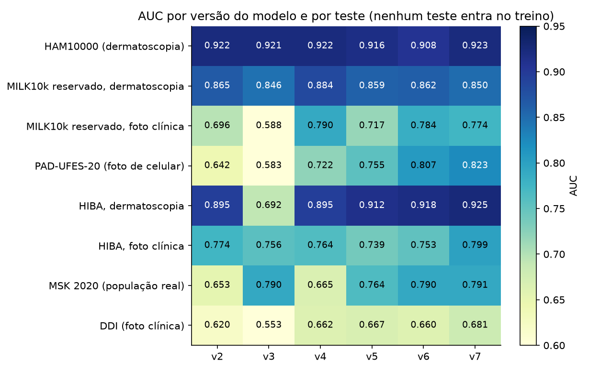
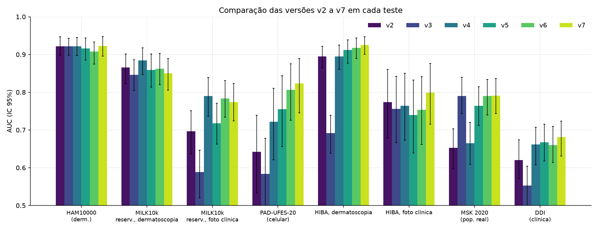
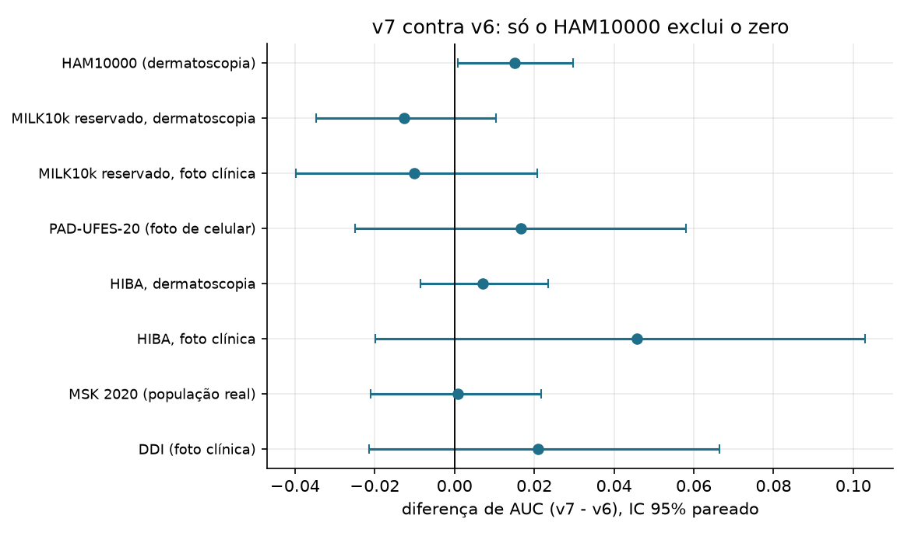
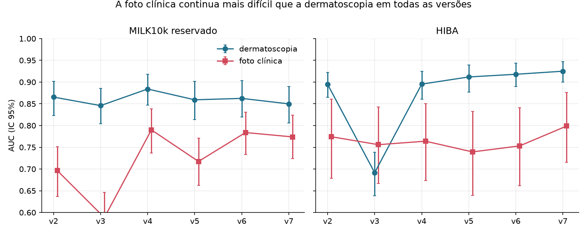
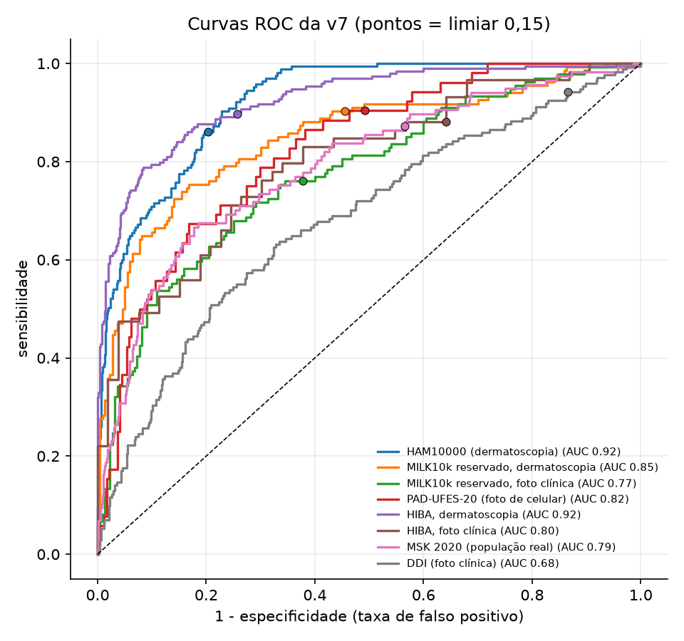
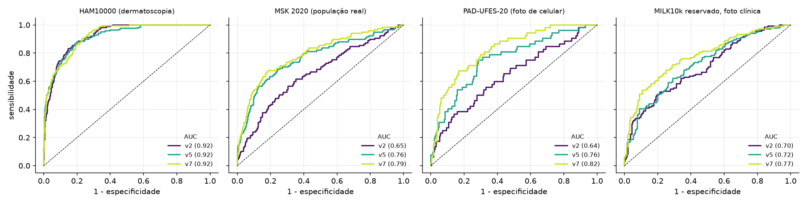
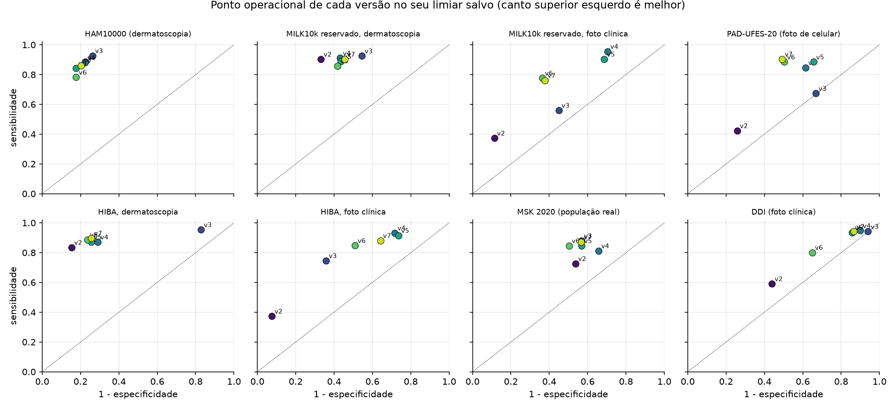

# 04 — Comparação e resultados (v2 a v7)

Todas as versões foram avaliadas nos **mesmos 8 testes** ([01 §3](01-visao-geral-e-metodologia.md#3-como-as-versões-foram-comparadas)),
com o limiar salvo em cada checkpoint. Tabelas geradas por `scripts/build_docs_report.py` a partir das previsões
salvas; CSVs em `data/`. A v1 não entra: o checkpoint não foi preservado ([03](03-historico-v1-a-v7.md)).

## 1. Resumo

- **A v7 é sustentadamente melhor que a v2 em 5 dos 8 testes e nunca pior.**
- **O teste do HAM10000 não distingue as versões** (AUC 0,908 a 0,923, tudo dentro do ruído). As diferenças
  aparecem nos **testes externos**.
- **Foto clínica segue sendo o ponto fraco**, em todas as versões.
- O **0,92 do HAM10000 superestima** o desempenho fora de casa: na população real (MSK 2020) a v2 tem AUC 0,653 e a
  v7, 0,791.

## 2. AUC por versão e teste (IC 95% por bootstrap de lesão)

| Teste | mel/nv | v2 | v3 | v4 | v5 | v6 | v7 |
|---|---|---|---|---|---|---|---|
| HAM10000 (dermatoscopia) | 165/1001 | 0,922 [0,898-0,947] | 0,921 [0,898-0,943] | 0,922 [0,898-0,945] | 0,916 [0,885-0,944] | 0,908 [0,875-0,933] | 0,923 [0,895-0,948] |
| MILK10k reservado, dermatoscopia | 134/220 | 0,865 [0,823-0,902] | 0,846 [0,805-0,886] | 0,884 [0,847-0,918] | 0,859 [0,814-0,902] | 0,862 [0,820-0,903] | 0,850 [0,806-0,890] |
| MILK10k reservado, foto clínica | 134/220 | 0,696 [0,637-0,751] | 0,588 [0,520-0,646] | 0,790 [0,737-0,839] | 0,717 [0,662-0,771] | 0,784 [0,734-0,831] | 0,774 [0,724-0,824] |
| PAD-UFES-20 (foto de celular) | 52/244 | 0,642 [0,534-0,739] | 0,583 [0,482-0,678] | 0,722 [0,621-0,810] | 0,755 [0,656-0,843] | 0,807 [0,726-0,876] | 0,823 [0,746-0,890] |
| HIBA, dermatoscopia | 194/549 | 0,895 [0,865-0,922] | 0,692 [0,638-0,739] | 0,895 [0,861-0,925] | 0,912 [0,877-0,939] | 0,918 [0,890-0,944] | 0,925 [0,900-0,947] |
| HIBA, foto clínica | 59/53 | 0,774 [0,679-0,861] | 0,756 [0,666-0,842] | 0,764 [0,673-0,850] | 0,739 [0,639-0,833] | 0,753 [0,662-0,841] | 0,799 [0,715-0,876] |
| MSK 2020 (população real) | 117/691 | 0,653 [0,598-0,703] | 0,790 [0,743-0,840] | 0,665 [0,609-0,720] | 0,764 [0,712-0,814] | 0,790 [0,740-0,834] | 0,791 [0,744-0,836] |
| DDI (foto clínica) | 171/485 | 0,620 [0,570-0,674] | 0,553 [0,497-0,604] | 0,662 [0,608-0,708] | 0,667 [0,618-0,715] | 0,660 [0,614-0,710] | 0,681 [0,631-0,724] |

A v3 tem resultados fortes e fracos ao mesmo tempo (MSK 0,790 mas HIBA dermatoscopia 0,692); ver
[03](03-historico-v1-a-v7.md#v3--mais-dado-do-mesmo-tipo-experimento-negativo).

## 3. Comparações pareadas (diferença de AUC, mesmas lesões reamostradas)

"Exclui zero?" = diferença sustentada (IC 95% pareado não inclui 0). A probabilidade é a fração das
reamostragens em que a **primeira** versão foi melhor.

### v7 − v2 (o ganho acumulado de todo o trabalho)

| Teste | dif. AUC | IC 95% pareado | P(v7 melhor) | exclui zero? |
|---|---|---|---|---|
| HAM10000 (dermatoscopia) | +0,001 | [-0,016 a 0,019] | 54% | não |
| MILK10k reservado, dermatoscopia | -0,016 | [-0,050 a 0,021] | 19% | não |
| MILK10k reservado, foto clínica | **+0,078** | [0,020 a 0,138] | 100% | **sim** |
| PAD-UFES-20 (foto de celular) | **+0,181** | [0,098 a 0,265] | 100% | **sim** |
| HIBA, dermatoscopia | **+0,030** | [0,010 a 0,055] | 99% | **sim** |
| HIBA, foto clínica | +0,025 | [-0,076 a 0,122] | 70% | não |
| MSK 2020 (população real) | **+0,139** | [0,095 a 0,185] | 100% | **sim** |
| DDI (foto clínica) | **+0,061** | [0,004 a 0,118] | 98% | **sim** |

### v7 − v6

| Teste | dif. AUC | IC 95% pareado | P(v7 melhor) | exclui zero? |
|---|---|---|---|---|
| HAM10000 (dermatoscopia) | **+0,015** | [0,001 a 0,030] | 98% | **sim** |
| MILK10k reservado, dermatoscopia | -0,013 | [-0,035 a 0,010] | 14% | não |
| MILK10k reservado, foto clínica | -0,010 | [-0,040 a 0,021] | 28% | não |
| PAD-UFES-20 (foto de celular) | +0,017 | [-0,025 a 0,058] | 78% | não |
| HIBA, dermatoscopia | +0,007 | [-0,008 a 0,024] | 80% | não |
| HIBA, foto clínica | +0,046 | [-0,020 a 0,103] | 92% | não |
| MSK 2020 (população real) | +0,001 | [-0,021 a 0,022] | 52% | não |
| DDI (foto clínica) | +0,021 | [-0,022 a 0,066] | 82% | não |

### Passos intermediários (o efeito de cada dataset)

**v6 − v5** (fotos clínicas sobreamostradas):

| Teste | dif. AUC | IC 95% pareado | exclui zero? |
|---|---|---|---|
| HAM10000 | -0,009 | [-0,022 a 0,006] | não |
| MILK10k foto clínica | **+0,066** | [0,027 a 0,106] | **sim** |
| PAD-UFES-20 | **+0,051** | [0,006 a 0,100] | **sim** |
| MSK 2020 | **+0,026** | [0,005 a 0,046] | **sim** |
| DDI | -0,007 | [-0,035 a 0,022] | não |
| demais | ≈ 0 | — | não |

**v5 − v4** (BCN20000):

| Teste | dif. AUC | IC 95% pareado | exclui zero? |
|---|---|---|---|
| MSK 2020 | **+0,099** | [0,056 a 0,144] | **sim** |
| MILK10k foto clínica | **−0,073** | [-0,113 a -0,031] | **sim (piora)** |
| PAD-UFES-20 | +0,034 | [-0,023 a 0,099] | não |
| demais | n.s. | — | não |

**v4 − v2** (MILK10k):

| Teste | dif. AUC | IC 95% pareado | exclui zero? |
|---|---|---|---|
| MILK10k foto clínica | **+0,094** | [0,037 a 0,151] | **sim** |
| PAD-UFES-20 | **+0,079** | [0,007 a 0,154] | **sim** |
| DDI | **+0,042** | [0,004 a 0,083] | **sim** |
| HAM10000, MSK, HIBA | ≈ 0 | — | não |

**v3 − v2** (ISIC 2020):

| Teste | dif. AUC | IC 95% pareado | exclui zero? |
|---|---|---|---|
| MSK 2020 | **+0,137** | [0,086 a 0,191] | **sim** |
| HIBA, dermatoscopia | **−0,203** | [-0,250 a -0,160] | **sim (piora)** |
| MILK10k foto clínica | **−0,108** | [-0,163 a -0,059] | **sim (piora)** |
| DDI | **−0,068** | [-0,115 a -0,016] | **sim (piora)** |
| HAM10000 | -0,001 | [-0,012 a 0,012] | não |

Tabela completa (todas as comparações e testes) em [`data/comparacao_pareada_auc.csv`](data/comparacao_pareada_auc.csv).

## 4. Dermatoscopia × foto clínica

A foto clínica é mais difícil que a dermatoscopia **em todas as versões e nas duas fontes que têm as duas**
(MILK10k e HIBA). O ganho da v4/v6/v7 em foto clínica reduz a lacuna, mas não a fecha (AUC clínica 0,75–0,82 contra
0,85–0,93 em dermatoscopia).

## 5. Curvas ROC

## 6. Sensibilidade e especificidade no limiar salvo (sens / espec)

Os limiares diferem entre versões (v2 0,21 · v3 0,28 · v4 0,22 · v5 0,14 · v6 0,14 · v7 0,15), então **sensibilidade e
especificidade não são diretamente comparáveis entre colunas**; a AUC é. Servem para ver o ponto de operação de cada
versão.

| Teste | v2 | v3 | v4 | v5 | v6 | v7 |
|---|---|---|---|---|---|---|
| HAM10000 (dermatoscopia) | 0,88 / 0,78 | 0,93 / 0,74 | 0,88 / 0,78 | 0,84 / 0,82 | 0,78 / 0,82 | 0,86 / 0,80 |
| MILK10k reservado, dermatoscopia | 0,90 / 0,67 | 0,93 / 0,45 | 0,91 / 0,57 | 0,89 / 0,56 | 0,86 / 0,58 | 0,90 / 0,55 |
| MILK10k reservado, foto clínica | 0,37 / 0,89 | 0,56 / 0,55 | 0,96 / 0,30 | 0,90 / 0,31 | 0,78 / 0,64 | 0,76 / 0,62 |
| PAD-UFES-20 (foto de celular) | 0,42 / 0,74 | 0,67 / 0,33 | 0,85 / 0,39 | 0,88 / 0,34 | 0,88 / 0,50 | 0,90 / 0,51 |
| HIBA, dermatoscopia | 0,84 / 0,85 | 0,95 / 0,17 | 0,87 / 0,71 | 0,87 / 0,74 | 0,89 / 0,77 | 0,90 / 0,74 |
| HIBA, foto clínica | 0,37 / 0,92 | 0,75 / 0,64 | 0,93 / 0,28 | 0,92 / 0,26 | 0,85 / 0,49 | 0,88 / 0,36 |
| MSK 2020 (população real) | 0,73 / 0,46 | 0,88 / 0,43 | 0,81 / 0,34 | 0,85 / 0,43 | 0,85 / 0,50 | 0,87 / 0,43 |
| DDI (foto clínica) | 0,59 / 0,56 | 0,94 / 0,06 | 0,95 / 0,10 | 0,94 / 0,14 | 0,80 / 0,35 | 0,94 / 0,13 |

Leituras:

- **v2:** limiar calibrado em dermatoscopia; em foto clínica deixa passar mais da metade dos melanomas
  (sensibilidade 0,37 no MILK10k e no HIBA).
- **v4/v5:** pegam quase todos os melanomas em foto clínica (0,90–0,96), mas **à custa de especificidade ~0,3**:
  marcam quase tudo como suspeito.
- **v6/v7:** pontos mais equilibrados em foto clínica (sensibilidade 0,76–0,90, especificidade 0,36–0,64), mas
  ainda longe de bons.
- **DDI:** especificidade muito baixa em todas as versões (0,06–0,56): o modelo não foi feito para esse conjunto
  (rótulo "maligno vs benigno" de 78 doenças).

## 7. Acurácia (e por que ela engana)

| Teste | v2 | v3 | v4 | v5 | v6 | v7 | "sempre benigno" |
|---|---|---|---|---|---|---|---|
| HAM10000 (dermatoscopia) | 79,1% | 76,5% | 79,2% | 82,7% | 81,7% | 80,5% | **85,8%** |
| MILK10k reservado, dermatoscopia | 75,7% | 63,3% | 69,8% | 68,6% | 68,6% | 68,1% | 62,1% |
| MILK10k reservado, foto clínica | 69,2% | 55,4% | 54,5% | 53,7% | 68,9% | 67,5% | 62,1% |
| PAD-UFES-20 (foto de celular) | 68,6% | 39,2% | 46,6% | 43,9% | 56,4% | 57,8% | **82,4%** |
| HIBA, dermatoscopia | 84,4% | 37,6% | 75,2% | 77,8% | 79,7% | 78,3% | 73,9% |
| HIBA, foto clínica | 63,4% | 69,6% | 62,5% | 60,7% | 67,9% | 63,4% | 47,3% |
| MSK 2020 (população real) | 50,1% | 49,8% | 41,1% | 49,3% | 54,7% | 49,8% | **85,5%** |
| DDI (foto clínica) | 56,9% | 29,0% | 32,2% | 34,9% | 46,8% | 34,5% | **73,9%** |

Em vários testes a acurácia fica **abaixo da de um modelo inútil** que responde sempre "benigno": o limiar foi
escolhido para **não perder melanoma** (sensibilidade alta), o que custa acurácia. Ver [06](06-limiares-e-metricas.md).

## 8. Resultado do teste interno (HAM10000) por versão

| Versão | n val | AUC val | AUC teste | limiar | sens | espec | acurácia | precisão | mel perdidos (de 165) | nevos marcados (de 1001) | épocas E1+E2 |
|---|---|---|---|---|---|---|---|---|---|---|---|
| v2 | 1157 | 0,922 | 0,922 | 0,21 | 0,885 | 0,775 | 79,1% | 0,394 | 19 | 225 | 5+12 |
| v3 | 1735 | 0,936 | 0,921 | 0,28 | 0,927 | 0,738 | 76,5% | 0,369 | 12 | 262 | — |
| v4 | 1393 | 0,918 | 0,922 | 0,22 | 0,879 | 0,778 | 79,2% | 0,395 | 20 | 222 | 5+12 |
| v5 | 2458 | 0,899 | 0,916 | 0,14 | 0,842 | 0,824 | 82,7% | 0,441 | 26 | 176 | 5+12 |
| v6 | 2458 | 0,901 | 0,908 | 0,14 | 0,782 | 0,823 | 81,7% | 0,422 | 36 | 177 | 5+12 |
| v7 | 2522 | 0,898 | 0,923 | 0,15 | 0,861 | 0,796 | 80,5% | 0,410 | 23 | 204 | 5+12 |

(O IC 95% da AUC do teste interno, por bootstrap de **imagem**, está nos gráficos de cada versão em
`figures/por_versao/graficos_vN/` e é mais estreito que o por lesão da §2.) Esses gráficos trazem: curvas de treino,
ROC, precisão×revocação, limiar, matrizes de confusão, distribuição dos scores, calibração e AUC por fonte.

## 9. Ressalvas estatísticas

- 8 testes × várias comparações: não corrigimos por comparações múltiplas. Tratamos como **sustentado** o que
  aparece de forma consistente (ex.: v7 − v2 em 5 testes), e como **sugestivo** um resultado isolado.
- O HIBA em foto clínica tem só 59 melanomas e 53 nevos; o PAD-UFES-20, 52 imagens de melanoma (36 lesões): os
  intervalos são largos.
- O MILK10k reservado foi escolhido **sem olhar o modelo**, mas as versões v4–v7 foram treinadas com a parte
  restante do mesmo dataset (outras lesões, mesma fonte): a comparação v2 × v4+ nele favorece
  versões que viram o MILK10k. Por isso o PAD-UFES-20, o HIBA e o DDI (fontes totalmente independentes) pesam mais
  na conclusão sobre foto clínica.
