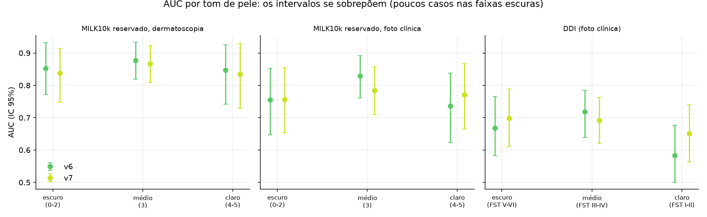
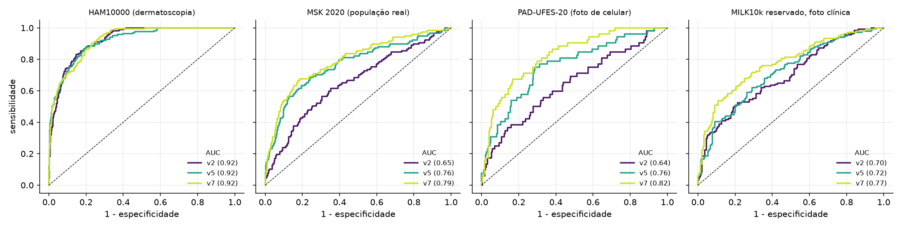
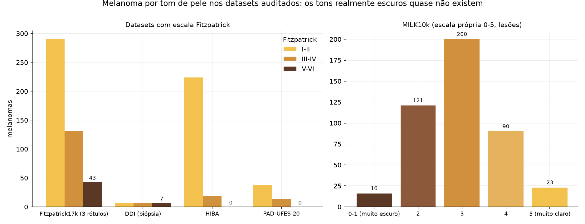

# 05 — Equidade por tom de pele

**Pergunta:** o desempenho muda entre tons de pele?
**Resposta curta:** em nenhum teste e em nenhuma versão encontramos uma diferença **sustentada** entre tons — mas os
dados disponíveis têm **pouquíssimo melanoma em pele realmente escura**, então **não conseguimos afirmar nem descartar
viés**. Isso é um achado sobre os dados abertos, não uma garantia sobre o modelo.

## 1. Como medimos

- **MILK10k reservado:** escala própria do dataset, **0 (muito escuro) a 5 (muito claro), que não é Fitzpatrick**.
  Agrupada em *escuro (0–2)*, *médio (3)* e *claro (4–5)*. Os níveis realmente escuros (0–1) têm só **16 melanomas**;
  o grupo "escuro" é, na prática, o nível 2 (121 melanomas).
- **DDI:** faixas Fitzpatrick I–II, III–IV e V–VI, com biópsia (7 melanomas por faixa).
- **Fitzpatrick17k:** escala Fitzpatrick do próprio dataset (ruidosa; ver §4).
- IC 95% por bootstrap de lesão (por imagem no Fitzpatrick17k, que não tem id de lesão).

## 2. MILK10k reservado (AUC [IC 95%])

**Dermatoscopia** (mel/nv por grupo: claro 34/65 · escuro 41/60 · médio 59/95)

| versão | escuro (0-2) | médio (3) | claro (4-5) |
|---|---|---|---|
| v2 | 0,835 [0,747-0,905] | 0,887 [0,822-0,941] | 0,862 [0,777-0,929] |
| v3 | 0,797 [0,703-0,878] | 0,860 [0,794-0,918] | 0,873 [0,803-0,936] |
| v4 | 0,868 [0,785-0,934] | 0,887 [0,828-0,936] | 0,892 [0,819-0,952] |
| v5 | 0,873 [0,792-0,948] | 0,875 [0,818-0,925] | 0,822 [0,716-0,917] |
| v6 | 0,852 [0,772-0,932] | 0,877 [0,819-0,933] | 0,847 [0,742-0,925] |
| v7 | 0,838 [0,748-0,914] | 0,868 [0,809-0,922] | 0,834 [0,729-0,930] |

**Foto clínica** (mesmos tamanhos de grupo)

| versão | escuro (0-2) | médio (3) | claro (4-5) |
|---|---|---|---|
| v2 | 0,641 [0,526-0,749] | 0,721 [0,630-0,799] | 0,715 [0,613-0,815] |
| v3 | 0,460 [0,344-0,584] | 0,643 [0,553-0,730] | 0,633 [0,510-0,746] |
| v4 | 0,755 [0,652-0,848] | 0,834 [0,761-0,893] | 0,753 [0,648-0,843] |
| v5 | 0,717 [0,608-0,818] | 0,760 [0,679-0,839] | 0,638 [0,514-0,747] |
| v6 | 0,755 [0,647-0,852] | 0,829 [0,761-0,891] | 0,736 [0,624-0,838] |
| v7 | 0,756 [0,654-0,855] | 0,784 [0,709-0,857] | 0,771 [0,664-0,867] |

**Leitura:** em dermatoscopia não há diferença detectável entre tons em nenhuma versão (intervalos sobrepostos).
Em foto clínica o grupo escuro fica abaixo do médio na maioria das versões (v2 a v6), mas os intervalos se sobrepõem
em todos os casos; na v7 os três grupos ficam praticamente iguais. Na v2 e na v3 a AUC do grupo escuro em foto clínica é
a mais baixa (0,64 e 0,46), isto é, os modelos que **nunca viram foto clínica** ficam piores justamente onde há menos
dado — mas a v3 também é pior em todos os outros grupos.

## 3. DDI (AUC [IC 95%])

(mel/nv por grupo: claro I–II 49/159 · médio III–IV 74/167 · escuro V–VI 48/159; "mel" aqui = maligno)

| versão | escuro (V–VI) | médio (III–IV) | claro (I–II) |
|---|---|---|---|
| v2 | 0,493 [0,382-0,597] | 0,667 [0,587-0,752] | 0,672 [0,585-0,752] |
| v3 | 0,455 [0,368-0,545] | 0,559 [0,484-0,645] | 0,625 [0,533-0,714] |
| v4 | 0,557 [0,442-0,661] | 0,729 [0,661-0,795] | 0,672 [0,586-0,760] |
| v5 | 0,661 [0,567-0,750] | 0,733 [0,654-0,802] | 0,580 [0,483-0,668] |
| v6 | 0,668 [0,583-0,765] | 0,718 [0,640-0,785] | 0,583 [0,501-0,677] |
| v7 | 0,699 [0,611-0,789] | 0,691 [0,620-0,764] | 0,652 [0,563-0,740] |

- A AUC da faixa escura **sobe a cada versão** (0,49 na v2 → 0,70 na v7), o que é encorajador, mas os intervalos
  são largos.
- **Na v4** a faixa escura ficou sustentadamente abaixo da média (diferença médio − escuro de +0,172, IC pareado
  [+0,040 a +0,297]). Esse resultado **desaparece a partir da v5**. Na **v7** nenhuma diferença entre faixas é
  sustentada (claro − escuro −0,051 [−0,180 a +0,074]; médio − escuro −0,007 [−0,128 a +0,110]).
- **Confundidor de doença:** no DDI, **56% dos casos malignos da faixa escura são linfoma cutâneo**, doença que o
  modelo nunca viu no treino. Uma comparação ingênua entre faixas mistura "tom de pele" com "tipo de doença". Por
  isso o DDI não permite concluir nada sobre melanoma por tom: **só há 7 melanomas por faixa**.
- A especificidade no DDI é muito baixa em todas as versões (0,06–0,56): o rótulo é "maligno vs benigno" de 78
  doenças, não a tarefa do modelo.

## 4. Fitzpatrick17k — o caso enganoso

O Fitzpatrick17k é o único dataset aberto com dezenas de melanomas em tons V–VI: **43 melanomas e 24 nevos** nos
tons V–VI (mais 4 imagens de lentigo maligna), além de 422 melanomas e 209 nevos nos tons I–IV.

### 4.1 Teste externo para as versões v2 a v6 (nenhuma treinou com ele)

Aqui o Fitzpatrick17k é uma fonte **independente** do treino. Melanoma vs nevo melanocítico, foto clínica de atlas.
AUC [IC 95% por bootstrap de imagem]:

| versão | claro (I–II) | médio (III–IV) | escuro (V–VI) |
|---|---|---|---|
| v2 | 0,702 [0,649-0,751] | 0,621 [0,539-0,696] | 0,665 [0,523-0,798] |
| v3 | 0,617 [0,560-0,672] | 0,544 [0,460-0,624] | 0,634 [0,488-0,766] |
| v4 | 0,746 [0,699-0,793] | 0,742 [0,666-0,808] | 0,710 [0,559-0,851] |
| v5 | 0,778 [0,730-0,825] | 0,667 [0,591-0,738] | 0,724 [0,575-0,859] |
| v6 | 0,766 [0,717-0,811] | 0,661 [0,585-0,737] | 0,672 [0,519-0,808] |

Não há diferença sustentada entre tons. Padrão sugestivo (n pequeno: 24 nevos na faixa escura): a **especificidade
cai conforme a pele escurece** em v5 e v6 (v6: 0,36 → 0,25 → 0,17; v5: 0,26 → 0,10 → 0,08), enquanto a
sensibilidade fica alta em todos os tons (0,86–0,98): em pele escura o modelo marca quase todo nevo como suspeito.
**É um sinal, não uma conclusão.**

### 4.2 O que deu errado na v7

A v7 treina com os tons I–IV do Fitzpatrick17k e foi avaliada nos tons V–VI, que ficaram fora do treino. A AUC
foi de 0,67 (v6) para **0,93** (v7). **Isso não é generalização para pele escura**:

| | v6 | v7 |
|---|---|---|
| Fitzpatrick17k **V–VI** (43 mel / 24 nv; nunca vistos) | 0,672 [0,523-0,811] | **0,928** [0,854-0,977] |
| Fitzpatrick17k **I–IV na validação** (43 mel / 21 nv; também nunca treinados, **mesma fonte**) | 0,592 [0,442-0,748] | **0,872** [0,782-0,953] |
| Fontes **independentes** (PAD-UFES-20, HIBA clínica, MILK10k clínica, DDI) | 0,660–0,807 | 0,681–0,823 (variação de −0,010 a +0,046) |

O salto aparece **igualmente nos tons claros da validação** (0,59 → 0,87), então o que a rede aprendeu foi o padrão
**deste atlas** (estilo da foto, composição), não a pele escura. O desenho "treina em I–IV, testa em V–VI" **não é
independente porque as duas partes vêm da mesma fonte**. O número de V–VI da v7 **não deve ser citado** como
desempenho em pele escura. O que se pode dizer: **dentro do atlas**, V–VI (0,93) ficou parecido com I–IV (0,87), isto
é, sem lacuna entre tons *dentro da fonte*.

Dados: [`data/fitzpatrick17k_tons_V_VI.csv`](data/fitzpatrick17k_tons_V_VI.csv) (a coluna
`mesma_fonte_do_treino` marca a v7).

## 5. Por que não conseguimos concluir

1. **Dados:** melanoma em tons V–VI é raro em todos os datasets abertos auditados (e **0** no arquivo inteiro do
   ISIC com tom V–VI anotado e diagnóstico de melanoma; [02 §3](02-datasets.md#3-auditoria-do-arquivo-do-isic-via-api-só-metadados)).
2. **Poder estatístico:** 7 melanomas por faixa no DDI, 41 melanomas no grupo "escuro" do MILK10k reservado (quase
   todos no nível 2), 43 no Fitzpatrick17k.
3. **Rótulos e tom ruidosos:** Fitzpatrick17k sem biópsia; duas anotações de tom concordam em 45,8%.
4. **Confundidores:** mix de doenças no DDI; fonte no Fitzpatrick17k.

## 6. O que podemos afirmar no TCC

- "Em nenhum teste e em nenhuma versão encontramos diferença **estatisticamente sustentada** entre tons de pele."
- "Os dados abertos disponíveis não têm melanoma em pele escura em quantidade suficiente para uma avaliação robusta;
  auditamos X bases e encontramos, na melhor das hipóteses, algumas dezenas de casos." (ver [02](02-datasets.md))
- "Há um sinal de mais falsos positivos em pele escura em foto clínica (Fitzpatrick17k), que merece investigação com
  dados melhores."
- **Não afirmar** que o modelo é "justo" nem "viesado" para pele escura, nem citar a AUC da v7 nos tons V–VI do
  Fitzpatrick17k como evidência.
- Trabalho futuro: coleta com parceria clínica ([07](07-limitacoes-e-trabalhos-futuros.md)).
