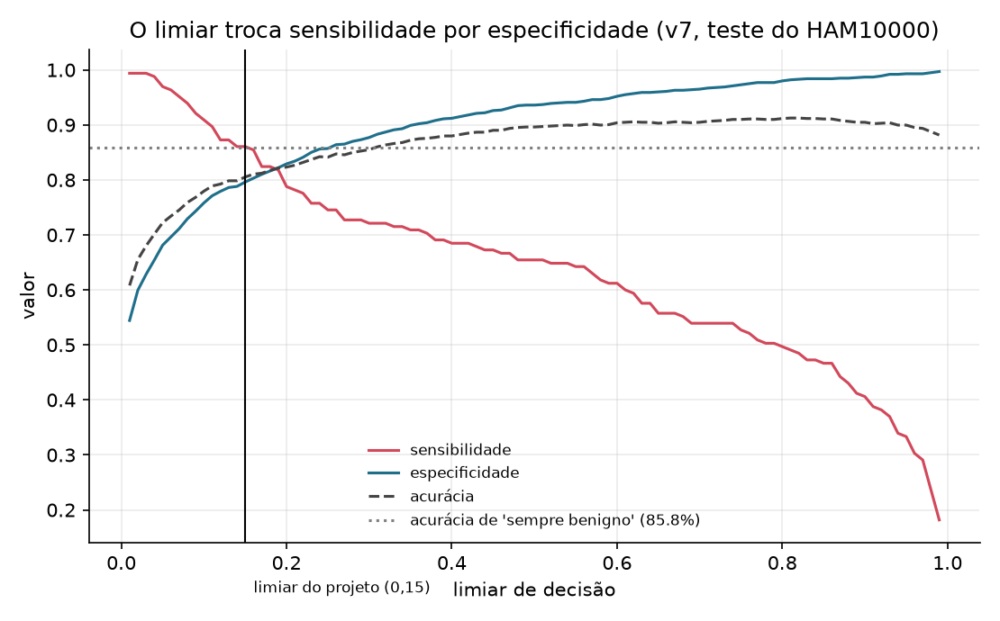
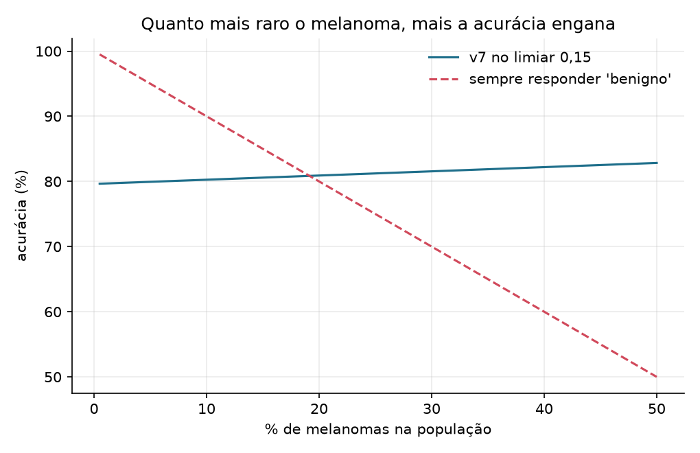

# 06 — Limiares e métricas

## 1. Do score à decisão

O modelo **não responde "é melanoma" ou "não é"**: devolve uma **probabilidade** (por exemplo, 12,7% ou 99,9%). O
**limiar** é a linha de corte: acima dela a lesão é marcada como **suspeita**, abaixo, como **benigna**. O limiar
é uma decisão de uso, não uma propriedade do modelo, e muda o par sensibilidade/especificidade sem mudar a AUC.

## 2. As métricas, com os números da v7

Teste do HAM10000 (1.166 imagens, 165 melanomas), limiar **0,15**:

| Métrica | O que responde | Valor | Em palavras |
|---|---|---|---|
| **Sensibilidade** | dos melanomas de verdade, quantos o modelo marca? | **0,861** | pega 142 de 165 e **perde 23** |
| **Especificidade** | dos nevos benignos, quantos o modelo deixa em paz? | **0,796** | 797 de 1.001 corretos; **204 alarmes falsos** |
| **Precisão** | dos marcados como suspeitos, quantos são melanoma? | 0,410 | 142 de 346 |
| **Valor preditivo negativo** | dos marcados como benignos, quantos são benignos? | ~0,972 | 797 de 820 |
| **AUC** | chance de um melanoma receber probabilidade maior que um nevo | **0,923** | independe do limiar |
| **Acurácia** | fração de acertos | 80,5% | **engana** (§4) |

Em triagem, **perder um melanoma é o pior erro**; por isso se mira sensibilidade alta, aceitando alarmes falsos
(uma consulta ou biópsia a mais). A sensibilidade sozinha não vale nada: um modelo que marca **tudo** como suspeito
tem sensibilidade 100% e especificidade 0. **Sempre cite as duas juntas.**

## 3. Como o limiar é escolhido

Regra do projeto: o **maior** limiar cuja sensibilidade na **validação** seja ≥ 0,90 (maior limiar = menos falsos
positivos dentro da meta). O teste **nunca** participa. Limiares salvos: v2 0,21 · v3 0,28 · v4 0,22 · v5 0,14 ·
v6 0,14 · v7 0,15.

Subir o limiar troca sensibilidade por especificidade. Exemplo na v7 (HAM10000): em 0,50 a especificidade é 0,94,
mas a sensibilidade cai para 0,65.

## 4. Acurácia e a meta de 98%

A acurácia **não é a métrica principal** porque depende de quantos melanomas existem e do limiar.

**Linha de base:** no teste do HAM10000, 85,8% das imagens são nevo. Um modelo que responde sempre "benigno" tem
**85,8% de acurácia** e não acha nenhum melanoma.

Acurácia da v7 no HAM10000 conforme a regra de escolha do limiar:

| Como o limiar é escolhido | Limiar | Acurácia | Sensibilidade | Especificidade |
|---|---|---|---|---|
| Regra do projeto (sensibilidade ≥ 0,90 na validação) | 0,15 | **80,5%** | 0,86 | 0,80 |
| Limiar padrão | 0,50 | 89,6% | 0,65 | 0,94 |
| Maximiza a **acurácia** na validação (válido) | 0,80 | **91,2%** | **0,50** | 0,98 |
| Melhor limiar escolhido **no teste** (otimista, **inválido**) | 0,81 | 91,3% | 0,49 | 0,98 |

O **máximo válido de acurácia é ~91%**, e só perdendo **metade** dos melanomas — um modelo pior para triagem. No
limiar que serve para triagem a acurácia é ~80%, **abaixo** da do "sempre benigno".

### A acurácia depende da prevalência

Com o limiar do projeto, a acurácia da v7 fica em ~80% quase independentemente de quantos melanomas há (81,6%
com 30% de melanoma, 79,7% com 1%), enquanto o "sempre benigno" sobe para 95% ou 99% quando o melanoma é raro. Numa
triagem real (melanoma raro), a acurácia perde o sentido.

### Por que "98%" não é adequado

- Não é alcançável de forma honesta aqui: o teto válido de acurácia é ~91%, e o de AUC fica em ~0,93–0,95
  (estimativa; [07](07-limitacoes-e-trabalhos-futuros.md)).
- Resultados ≥ 98% na literatura costumam vir de **vazamento** (split por imagem em vez de por lesão, duplicatas).
- A meta defensável é outra: **sensibilidade alta com especificidade aceitável** (por exemplo, sensibilidade ≥ 0,90
  com especificidade ≥ 0,80). A v7 está em 0,86 / 0,80 no HAM10000 e em 0,87 / 0,43 na população real (MSK 2020).

## 5. Limiar por modalidade

**Problema:** o limiar único é escolhido numa validação que mistura dermatoscopia e foto clínica. Em foto clínica ele
dá sensibilidade alta e especificidade baixa (0,10–0,35 em várias versões).

**Experimento (sem retreinar):** escolher limiares **separados por modalidade, só na validação**, e aplicar aos
testes externos (que nunca entram na escolha). Duas políticas:

- **A:** maior limiar com sensibilidade ≥ 0,90 na validação **da modalidade** (a regra do projeto);
- **B (Youden):** o limiar que maximiza sensibilidade + especificidade − 1 (ponto equilibrado).

Limiares escolhidos (validação de cada versão):

| Versão | dermatoscopia A / B | foto clínica A / B |
|---|---|---|
| v2 | 0,21 / 0,19 | **0,01** / 0,07 |
| v4 | 0,21 / 0,35 | 0,27 / 0,75 |
| v5 | 0,14 / 0,29 | 0,17 / 0,29 |
| v6 | 0,14 / 0,31 | **0,01** / 0,31 |
| v7 | 0,16 / 0,37 | **0,05** / 0,42 |

Limiar clínico A = 0,01 (v2, v6) ou 0,05 (v7) é **degenerado**: não se atinge 90% de sensibilidade na validação
clínica sem marcar quase tudo. A validação clínica é **pequena** (44 melanomas e 74 nevos até a v6; 87 e 95 na v7), então
o limiar clínico é **ruidoso**.

### Foto clínica (sensibilidade / especificidade)

**Limiar único (atual)**

| Teste | v2 | v4 | v5 | v6 | v7 |
|---|---|---|---|---|---|
| MILK10k reservado | 0,37 / 0,89 | 0,96 / 0,30 | 0,90 / 0,31 | 0,78 / 0,64 | 0,76 / 0,62 |
| PAD-UFES-20 | 0,42 / 0,74 | 0,85 / 0,39 | 0,88 / 0,34 | 0,88 / 0,50 | 0,90 / 0,51 |
| HIBA | 0,37 / 0,92 | 0,93 / 0,28 | 0,92 / 0,26 | 0,85 / 0,49 | 0,88 / 0,36 |
| DDI | 0,59 / 0,56 | 0,95 / 0,10 | 0,94 / 0,14 | 0,80 / 0,35 | 0,94 / 0,13 |

**Política A (sensibilidade ≥ 0,90 por modalidade)**

| Teste | v2 | v4 | v5 | v6 | v7 |
|---|---|---|---|---|---|
| MILK10k reservado | 0,94 / 0,21 | 0,92 / 0,35 | 0,87 / 0,38 | 0,96 / 0,19 | 0,81 / 0,48 |
| PAD-UFES-20 | 0,96 / 0,11 | 0,81 / 0,44 | 0,85 / 0,41 | 1,00 / 0,14 | 0,96 / 0,32 |
| HIBA | 0,90 / 0,23 | 0,92 / 0,36 | 0,90 / 0,34 | 0,93 / 0,09 | 0,97 / 0,26 |
| DDI | 0,99 / 0,02 | 0,93 / 0,15 | 0,91 / 0,19 | 0,99 / 0,05 | 0,98 / 0,05 |

**Política B (Youden, equilibrada)**

| Teste | v2 | v4 | v5 | v6 | v7 |
|---|---|---|---|---|---|
| MILK10k reservado | 0,62 / 0,66 | 0,59 / 0,81 | 0,74 / 0,54 | 0,67 / 0,75 | 0,65 / 0,77 |
| PAD-UFES-20 | 0,69 / 0,49 | 0,56 / 0,82 | 0,81 / 0,53 | 0,77 / 0,67 | 0,81 / 0,67 |
| HIBA | 0,71 / 0,77 | 0,56 / 0,77 | 0,76 / 0,49 | 0,78 / 0,66 | 0,83 / 0,62 |
| DDI | 0,87 / 0,19 | 0,57 / 0,66 | 0,83 / 0,35 | 0,67 / 0,53 | 0,85 / 0,33 |

### Dermatoscopia (sensibilidade / especificidade)

**Política A** (praticamente igual ao limiar único, porque a dermatoscopia domina a validação)

| Teste | v2 | v4 | v5 | v6 | v7 |
|---|---|---|---|---|---|
| HAM10000 | 0,88 / 0,78 | 0,88 / 0,78 | 0,84 / 0,82 | 0,78 / 0,82 | 0,85 / 0,80 |
| HIBA | 0,84 / 0,85 | 0,87 / 0,70 | 0,87 / 0,74 | 0,89 / 0,77 | 0,89 / 0,76 |
| MSK 2020 | 0,73 / 0,46 | 0,83 / 0,32 | 0,85 / 0,43 | 0,85 / 0,50 | 0,86 / 0,45 |

**Política B**

| Teste | v2 | v4 | v5 | v6 | v7 |
|---|---|---|---|---|---|
| HAM10000 | 0,88 / 0,76 | 0,82 / 0,84 | 0,73 / 0,90 | 0,67 / 0,91 | 0,70 / 0,90 |
| HIBA | 0,84 / 0,83 | 0,84 / 0,81 | 0,83 / 0,88 | 0,82 / 0,88 | 0,80 / 0,88 |
| MSK 2020 | 0,75 / 0,43 | 0,70 / 0,48 | 0,74 / 0,65 | 0,78 / 0,70 | 0,76 / 0,65 |

Dados completos: [`data/limiar_por_modalidade.csv`](data/limiar_por_modalidade.csv).

### O que isso mostra

1. **A política A quase não muda nada.** Exigir 90% de sensibilidade por modalidade só melhora a especificidade em
   foto clínica em ~0,05. **Um limiar escolhe um ponto na curva ROC, mas não cria discriminação**: com AUC clínica
   de 0,75–0,82, a especificidade fica limitada a ~0,35–0,45 quando a sensibilidade é 0,90.
2. **A política B dá um ponto equilibrado e estável.** Na v4, o limiar 0,75 escolhido na validação deu sensibilidade
   ~0,57 com especificidade 0,66–0,82 em quatro testes independentes — mas perde ~43% dos melanomas.
3. **A v2 é degenerada em foto clínica** (limiar A = 0,01): nunca viu foto clínica.
4. **Nenhuma regra de limiar dá sensibilidade e especificidade altas ao mesmo tempo em foto clínica.** Melhorar isso
   exige um modelo melhor (mais dado clínico), não outro limiar.

## 6. Como relatar no TCC

- Apresentar **AUC** (independe do limiar) e **sensibilidade/especificidade em um ponto de operação declarado**,
  nunca a acurácia sozinha.
- Mostrar o **trade-off** (curva ROC e figura do limiar) e dizer qual ponto foi escolhido e **por quê**
  (sensibilidade ≥ 0,90 na validação).
- Dizer explicitamente que a **acurácia de "sempre benigno" é 85,8%** no teste e que o modelo, no limiar de
  triagem, tem acurácia menor — de propósito.
- Para foto clínica, apresentar os pontos A e B como **opções**, e não como um limiar "otimizado".

Frase pronta: *"Em dermatoscopia, o modelo detecta cerca de 86% dos melanomas, com cerca de 80% dos nevos
corretamente descartados (AUC 0,92). Em foto comum o desempenho é menor, e mostramos isso com testes em fontes
independentes."*
