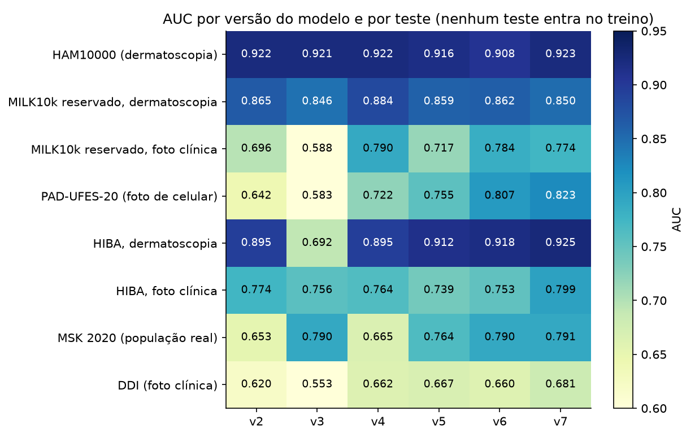

# Tonare — documentação da pesquisa

Triagem de **melanoma** por imagem (classificador `mel` vs `nv`, ResNet50 com transfer learning) com análise de
**equidade entre tons de pele**. Esta pasta reúne tudo o que foi feito, medido e descoberto: dados, versões do
modelo (v1 a v7), comparações, gráficos, limitações e como reproduzir.

> **Aviso:** é um projeto de pesquisa (TCC). Não é dispositivo médico e **nunca** substitui avaliação médica.

## Resultado em uma tela

- **Modelo de referência: v7** (ResNet50, limiar 0,15), treinado com HAM10000 + MILK10k + BCN20000 +
  Fitzpatrick17k (tons I-IV).
- **Dermatoscopia (teste do HAM10000, 165 melanomas):** AUC **0,923**, sensibilidade **0,861**,
  especificidade **0,796**.
- **Contra a v2 (primeiro modelo sólido), a v7 é melhor de forma estatisticamente sustentada em 5 dos 8 testes e
  nunca pior:** PAD-UFES-20 (+0,181 de AUC), MSK 2020 (+0,139), MILK10k foto clínica (+0,078), DDI (+0,061),
  HIBA dermatoscopia (+0,030). No HAM10000 ficou igual (+0,001).
- **Foto clínica continua sendo o ponto fraco** (AUC 0,68 a 0,82 conforme o teste, especificidade baixa).
- **Tom de pele:** sem diferença sustentada entre faixas em nenhum teste, mas há **pouquíssimo melanoma em pele
  escura nos datasets abertos** (tons realmente escuros: poucas dezenas de casos). Isso é a principal limitação.
- **Meta de "98% de acurácia" não é adequada:** com ~86% de nevos no teste, "sempre benigno" já dá 85,8% de
  acurácia. A acurácia da v7 no limiar de triagem é 80,5%; o máximo válido é ~91%, mas só perdendo metade dos
  melanomas. Usamos AUC e sensibilidade/especificidade (ver [06](06-limiares-e-metricas.md)).

## Índice

| Documento | Conteúdo |
|---|---|
| [01 — Visão geral e metodologia](01-visao-geral-e-metodologia.md) | problema, pipeline, treino, avaliação, controles contra vazamento |
| [02 — Datasets](02-datasets.md) | datasets usados, auditoria do arquivo do ISIC, descartados, vazamentos, licenças, log da pesquisa |
| [03 — Histórico das versões v1 a v7](03-historico-v1-a-v7.md) | o que mudou em cada versão, por quê, resultado e lição |
| [04 — Comparação e resultados](04-resultados-comparacao.md) | tabelas completas com IC 95%, testes pareados, gráficos |
| [05 — Equidade por tom de pele](05-fairness-tom-de-pele.md) | análise por tom, escassez de dados, o caso enganoso do Fitzpatrick17k |
| [06 — Limiares e métricas](06-limiares-e-metricas.md) | sensibilidade, especificidade, limiar, acurácia, limiar por modalidade |
| [07 — Limitações e trabalhos futuros](07-limitacoes-e-trabalhos-futuros.md) | o que não conseguimos afirmar e como melhorar |
| [08 — Reprodução](08-reproducao.md) | scripts, ordem de execução, Kaggle, mapeamento dos notebooks |

## Pastas

- `figures/` — gráficos de comparação entre versões (`fig01` a `fig13`).
- `figures/por_versao/graficos_vN/` — 8 gráficos + `resumo_vN.json` de cada versão (curvas de treino, ROC,
  precisão×revocação, limiar, matrizes de confusão, distribuição dos scores, calibração, AUC por fonte).
- `data/` — tabelas em CSV usadas em todos os documentos (ver [08](08-reproducao.md#8-tabelas-em-docsdata)).

## Convenções

- Números com vírgula decimal. **IC 95%** por bootstrap **de lesão** (as duas fotos de uma lesão não são
  independentes), salvo onde indicado.
- "**mel**" = melanoma, "**nv**" = nevo melanocítico (a classe negativa do modelo).
- Os testes externos **nunca** entram no treino de nenhuma versão (exceção documentada: o Fitzpatrick17k na v7,
  ver [05](05-fairness-tom-de-pele.md)).
- A numeração v1 a v7 é a do projeto. Os notebooks exportados do Kaggle tinham **nomes deslocados em um**;
  as cópias já corrigidas estão em `notebooks/kaggle_executados/` (`tonare_v2_executado.ipynb` … `v7`;
  ver [08](08-reproducao.md#mapeamento-dos-notebooks-do-kaggle)). A **v1 original não tem notebook** (só números).
